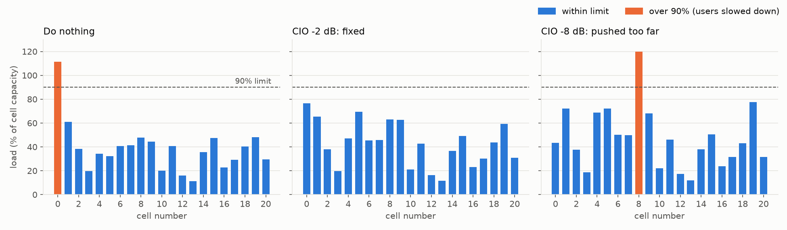
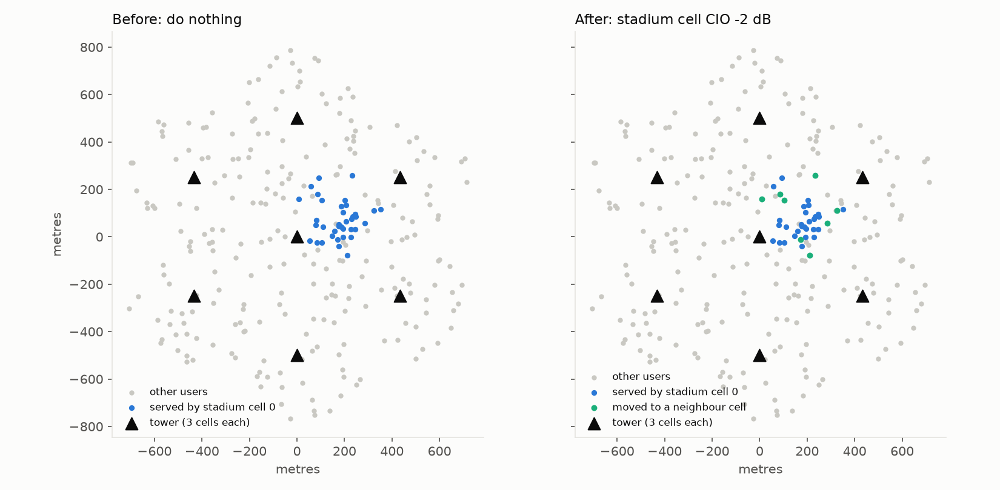
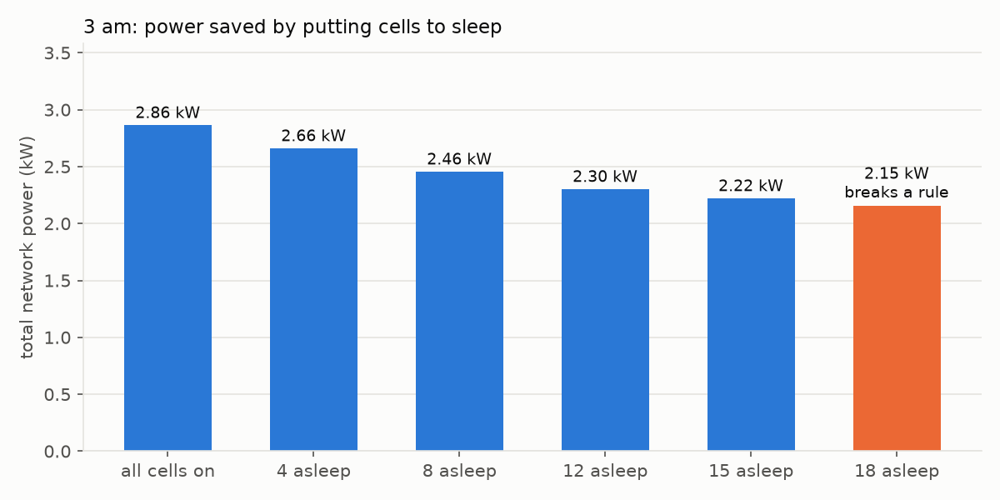

# BTP prototype, explained from scratch

A newcomer's guide to everything in this folder: what each file does, what each chart
shows, how "decisions" are made today, and what is still missing.

Written 28 Sept 2026. All numbers below were re-run from the code (seed 3) and match the charts.

---

## 0. The short answer

**Is there a digital twin yet? No.**

What exists today:

| Built | Purpose |
|---|---|
| `sim.py` | **Sim A**: a pretend "real" 5G network (physics + rules) |
| `demo.py` | Two what-if experiments on Sim A, printed as tables and saved as 3 charts |
| `make_dataset.py` | A data factory that produces training data for the future ML "fast guesser" |

What does **not** exist yet: the twin's state guess, the fast guesser (ML model), conformal
uncertainty ranges, Sim B (the slow checker), and the controller that makes decisions.
Those are the actual research and come next.

Total code: about 400 lines of Python.

---

## 1. The whole idea with an everyday analogy

Think of a city's traffic police:

| City analogy | 5G term | In our project |
|---|---|---|
| The real city with its cars and jams | The physical network | **Sim A** (`sim.py`) |
| A car | A phone (UE) | Randomly dropped users |
| A traffic crossing | A **cell** | 21 cells |
| "How jammed is this crossing" | PRB utilisation (%) | `prb_util_pct` |
| Each crossing phones HQ with a summary | KPM report | `sim.kpm_report(...)` |
| Police HQ that decides what to change | RIC + our rApp (controller) | **not built yet** |
| Diverting cars from a jammed road | Changing **CIO** | `cio_db` argument |
| Closing a quiet road at night | **Cell sleep** | `asleep` argument |
| HQ's quick mental picture of the city | The **digital twin** | **not built yet** |
| A slow, careful rehearsal before acting | High-fidelity simulation (**Sim B**) | **not built yet** |

The key rule: **HQ never sees where each car is.** It only gets the crossing summaries.
The twin must guess what will happen from those summaries alone.

---

## 2. Telecom basics you need (plain words)

- **Tower (site) and cell.** A tower has 3 antenna panels, each pointing a different way and
  covering a 120-degree slice. Each slice is a *cell*. 7 towers x 3 = 21 cells.
- **PRB (Physical Resource Block).** One unit of radio capacity. Picture a bank with 51
  counters (20 MHz of spectrum = 51 PRBs). Every phone needs some fraction of those counters.
- **PRB utilisation / load.** Percent of counters busy. Above about 90% the cell is jammed.
  Above 100% there is more demand than capacity, so everyone gets slowed down.
- **Signal strength (dBm).** How loud a cell sounds at your phone. Falls with distance.
- **SINR (signal quality).** Your cell's loudness compared with noise plus interference from
  other cells. High SINR = clean signal = you need **fewer** counters. Low SINR = you need
  **more** counters for the same video.
- **dB.** A log scale. +3 dB is roughly double, -3 dB is roughly half.
- **CIO (Cell Individual Offset).** A fake handicap or bonus (in dB) added to a cell when
  phones choose who to connect to. CIO -2 dB on a cell makes it look 2 dB weaker. Phones
  in the middle of the cell do not care; phones on the **edge**, where a neighbour is almost
  as loud, switch to the neighbour. This is how operators "move users from A to B".
- **Cell sleep.** Switching off a spare cell at low traffic to save electricity.
- **KPM report.** The per-cell "report card" a base station sends to the controller:
  busy counters, number of phones, average speed, slowest speeds, power, and so on.

---

## 3. `sim.py`: the pretend real network (Sim A)

This is the physics engine. Everything else uses it.

### 3.1 Constants and the map (lines 16-36)

- `ISD_M = 500`: towers are 500 m apart. One tower sits in the centre and six surround it in a hexagon.
- `SECTOR_AZIMUTHS_DEG = (30, 150, 270)`: the 3 directions each tower's panels face.
- Cells are numbered 0-20: cells 0, 1, 2 are on the centre tower, 3, 4, 5 on the next, and so on.
- `FREQ_GHZ = 3.5`, `BW_HZ = 20e6`, `N_PRB = 51`: a typical mid-band 5G cell.
- `TX_POWER_DBM = 46`: each cell transmits about 40 W.
- Antenna: 8 dBi gain, 65-degree beamwidth, 30 dB weaker behind the panel.
- `SHADOW_STD_DB = 6`: random loss that stands in for buildings.
- `POOR_SINR_DB = -5`: below this, a phone would likely drop its connection.
- Power model constants (`P0_W`, `DELTA_P`, `PMAX_W`, `PSLEEP_W`): see section 3.6.

All constants live here and nowhere else, so every script agrees on them.

### 3.2 Dropping phones: `drop_users` and `SCENARIOS` (lines 39-67)

- Phones are scattered uniformly around each tower.
- Each phone wants 0.5 to 1.5 Mbit/s (roughly a video stream).
- `SCENARIOS` defines three situations:

| Scenario | Phones per tower | Extra crowd | Total phones (seed 3) |
|---|---|---|---|
| `normal` | 35 | none | 245 |
| `stadium` | 35 | 30 phones around (180 m, 0 m), spread 80 m | 275 |
| `night` | 8 | none | 56 |

The stadium crowd sits just east of the centre tower, right in front of **cell 0**.

### 3.3 How loud each cell is at each phone: `received_power_dbm` (lines 70-80)

For every (phone, cell) pair:

```
received power = 46 dBm (transmit) + antenna gain - path loss
path loss      = 13.54 + 39.08 * log10(3D distance) + 20 * log10(3.5 GHz)   # 3GPP TR 38.901 city formula
                 + random 6 dB shadowing
antenna gain   = 8 dBi minus a penalty that grows as you move away from where the panel points
```

Example: a phone 250 m away, straight in front of a panel, loses about 118 dB, so it hears
roughly 46 + 8 - 118 = -64 dBm.

The output is a table of shape (number of phones, 21): "how loud each cell is at each phone".
**This is the hidden truth.** The twin must never see it.

### 3.4 One control period: `simulate` (lines 83-111)

This is the heart of the file. Inputs: the loudness table, each phone's demand, the CIO per
cell and which cells are asleep.

1. **Who connects where (line 94).** Each phone joins the awake cell with the highest
   `received power + CIO`. Sleeping cells are treated as minus infinity, so nobody joins them.
2. **Signal quality.** SINR = own cell's power / (interference from others + noise).
   A neighbour only interferes in proportion to how busy it is.
3. **Counters each phone needs.**
   ```
   efficiency = 0.6 * log2(1 + SINR)          # bits per second per Hz, clipped to 0.05 .. 5.5
   share      = demand / (20 MHz * efficiency) # fraction of the cell this phone uses
   ```
   Example with 1 Mbit/s demand:
   - good signal (SINR 10 dB): about 2.4% of a cell
   - poor signal (SINR 0 dB): about 8% of a cell, over 3x as much

   **This is why moving edge phones onto a neighbour is expensive for the neighbour**: those
   phones arrive with weak signal.
4. **The chicken-and-egg loop (lines 98-105).** Load depends on interference, but interference
   depends on load. So the code starts by assuming 50% load everywhere, then repeats
   "compute interference -> compute load" 80 times, moving halfway each time
   (damping 0.5), until the numbers settle.
5. **Overload (line 107).** If a cell's load is above 100%, every phone in it gets
   `demand / load`. At 111% load, each phone gets about 90% of what it wanted.

It returns, per phone: serving cell, SINR, throughput; and per cell: load and asleep flag.

### 3.5 What each cell reports upward: `kpm_report` (lines 114-142)

These are **the only numbers the twin and controller are allowed to see**. Dotted names
follow 3GPP TS 28.552 (the same names used in E2SM-KPM).

| Field | Plain meaning |
|---|---|
| `RRU.PrbUsedDl` | Counters busy (out of 51) |
| `RRU.PrbAvailDl` | Counters available (always 51) |
| `prb_util_pct` | Percent busy (capped at 100) |
| `RRC.ConnMean` | Number of phones connected |
| `DRB.UEThpDl` | Average speed per phone (Mbit/s) |
| `DRB.UEThpDl_p5` | Speed of the slowest 5% of phones |
| `PEE.AvgPower` | Electricity used (W) |
| `edge_share` | Fraction of this cell's phones whose second-best cell is within 3 dB, i.e. "how many would move if I nudge CIO" |
| `asleep` | Whether the cell is sleeping |

Example report, stadium scenario, before any action (cell 0 is the jammed one):

```
cell 0:  51/51 PRBs busy (100%), 37 phones, avg 0.84 Mbit/s, slowest 0.50, 318 W, edge_share 0.297
cell 1:  31/51 PRBs busy (60.9%), 17 phones, avg 1.04 Mbit/s, slowest 0.62, 244.5 W, edge_share 0.294
```

### 3.6 Power model

EARTH-style model (Auer et al. 2011), approximate values:

```
awake cell  : 130 W + 4.7 * 40 W * load   -> 130 W idle, 318 W at full load
asleep cell : 75 W
```

### 3.7 `summary` (lines 145-155)

Four network-wide scores used to judge an action:

- `worst_cell_util_pct`: busiest cell's load (capped at 100)
- `users_fully_served_pct`: phones getting everything they asked for
- `poor_signal_users_pct`: phones below -5 dB SINR
- `total_power_w`: electricity for all 21 cells

---

## 4. `demo.py`: two what-if experiments and the 3 charts

Run with `python3 demo.py` (Windows: `py demo.py`). Uses seed 3, so results are identical every run.

**The safety rule** (`is_safe`, line 28): an action is **SAFE** only if every cell is at or
below 90% busy **and** zero phones have poor signal. Otherwise it "breaks a rule".

### 4.1 Demo 1: stadium surge (`stadium_demo`)

The code finds the most overloaded cell (**cell 0**, centre tower, facing the stadium), then
tries CIO of 0, -2, -4, -6, -8, -10 dB on that one cell.

| CIO on cell 0 | Phones moved off cell 0 | Worst cell | Fully served | Total power | Verdict |
|---|---|---|---|---|---|
| 0 (do nothing) | 0 | 100% (really 111%, cell 0) | 86.5% | 4236 W | breaks rule |
| **-2 dB** | 8 | **76.4%** (cell 0) | **100%** | 4418 W | **SAFE** |
| -4 dB | 12 | 83.9% (cell 19) | 100% | 4447 W | SAFE |
| -6 dB | 15 | 100% (**cell 8**) | 95.3% | 4550 W | breaks rule |
| -8 dB | 18 | 100% (cell 8) | 94.5% | 4561 W | breaks rule |
| -10 dB | 23 | 100% (cell 8) | 86.5% | 4620 W | breaks rule |

**Lessons:**

1. A small push fixes the jam. Too big a push just **moves the jam next door** (cell 8).
   This is not obvious in advance, which is exactly why you want to test an action before applying it.
2. **Power goes up** after the fix (4236 -> 4418 W). Moved phones have weaker signal in their
   new cell, so they use more counters there.
3. The table caps load at 100%; the chart shows the raw value (111%). Same situation, two ways of measuring.

#### Chart: `results/stadium_loads.png`



Three bar charts, one bar per cell, dashed line = 90% limit. Blue = within limit, orange = over.

- **Left, "Do nothing":** cell 0 is orange at about 111%. Everything else is fine.
- **Middle, "CIO -2 dB: fixed":** all blue. Cell 0 drops to about 76%; cells 1, 5, 8, 9 rise a bit because they absorbed the moved phones.
- **Right, "CIO -8 dB: pushed too far":** cell 0 is now fine (about 43%) but **cell 8 is orange at about 120%**.

#### Chart: `results/stadium_map.png`



A bird's-eye view in metres. Black triangles are towers (3 cells each). Grey dots are other phones.

- **Left, before:** blue dots are phones on cell 0. The stadium crowd is visible just east of the centre tower.
- **Right, after CIO -2 dB:** **8 green dots** are phones that moved to a neighbour. They sit on the
  **edges** of the crowd, not in its centre. That is CIO working as designed: only edge phones move.

### 4.2 Demo 2: 3 am (`night_demo`)

Only 56 phones in the whole network. The code sorts cells from quietest to busiest and puts
the quietest 0, 4, 8, 12, 15, 18 cells to sleep.

| Cells asleep | Worst cell | Fully served | Poor-signal phones | Total power | Verdict |
|---|---|---|---|---|---|
| 0 | 8.7% | 100% | 0% | 2.86 kW | SAFE |
| 4 | 9.3% | 100% | 0% | 2.66 kW | SAFE |
| 8 | 11.8% | 100% | 0% | 2.46 kW | SAFE |
| 12 | 36.3% | 100% | 0% | 2.30 kW | SAFE |
| **15** | 49.5% | 100% | 0% | **2.22 kW** | **SAFE (22% saved)** |
| 18 | **100%** | **7.1%** | **25%** | 2.15 kW | breaks rule |

**Lesson:** you can save about 22% of the power, but there is a cliff between 15 and 18
sleeping cells. With only 3 cells awake, a quarter of the phones have terrible signal and
the survivors are jammed. You need to know where the cliff is **before** you act.

#### Chart: `results/night_power.png`



One bar per option, labelled with total power. Five blue (safe) bars fall from 2.86 to 2.22 kW;
the orange "18 asleep" bar is labelled "breaks a rule".

---

## 5. `make_dataset.py`: the data factory for the future fast guesser

Run with `python3 make_dataset.py --samples 500`. Takes about 5 seconds.

### 5.1 What one sample is

For each sample (seeds 1000, 1001, ... so every sample can be regenerated):

1. Pick a random scenario (`normal`, `stadium`, `night`). For stadium, the crowd gets a random
   position (within +-400 m), size (10-40 phones) and spread (40-120 m).
2. Pick random **current settings**: about 10% of cells get a random CIO; at night about 30% of cells are asleep.
3. Pick a random **new action**: about 30% of cells get a random CIO from {-6, -4, -2, 0, 2, 4, 6} dB; at night a random 30% sleep.
4. Run the simulator twice on the **same phones**: once with current settings (**before**), once with the action (**after**).
5. Write **one row per cell** (21 rows per sample).

The ML guesser will later learn: "given the before-reports and the action, predict the after-reports".

### 5.2 `results/dataset.csv`

10,500 rows = 500 samples x 21 cells. Mix: 170 normal, 173 stadium, 157 night.

| Column group | Role |
|---|---|
| `sample`, `seed`, `scenario`, `cell` | Bookkeeping. **Never feed `seed` or `scenario` to a model** (a real controller would not know them) |
| `before_asleep`, `before_cio_db`, `before_<kpm>` | Inputs: the situation now |
| `action_asleep`, `action_cio_db` | Inputs: what we plan to change |
| `after_<kpm>` | Labels: what the model must predict |

`<kpm>` is one of: `prb_util_pct`, `RRC.ConnMean`, `DRB.UEThpDl`, `DRB.UEThpDl_p5`, `PEE.AvgPower`, `edge_share`.

Phone positions are never saved: the twin must work from reports only.

### 5.3 `results/edges.csv`

258 rows listing which cells are neighbours (same tower or an adjacent tower), with the
distance between their towers. This is the "map" a graph neural network (GNN) would use:
each cell is a node, each neighbour link is an edge.

---

## 6. How decisions are made: today vs the plan

### 6.1 Today

There is **no decision-making code yet**. In `demo.py`, a human-written `for` loop tries a few
options on the **true** simulator, which knows exactly where every phone is. That is really the
**oracle** baseline ("perfect foresight"), the best anyone could do. It is **not** the twin
deciding. Presenting it as the twin would be "peeking at the answer" (design rule 2 in `CLAUDE.md`).

### 6.2 The plan (the research)

```
 Sim A  --KPM reports-->  Controller (RIC + our rApp)  --"what if X?"-->  Digital twin
 (pretend real network)          |                                        1. state guess from reports
   ^                             |                                        2. fast guesser + conformal range
   +-------- apply chosen -------+                                        3. slow checker = Sim B
```

One decision, step by step:

1. **Sim A** sends its KPM reports (per cell).
2. **State guess:** the twin rebuilds a *fake* network from the reports only
   (e.g. "cell 0 has 37 phones", placed at random positions inside cell 0).
3. For every candidate action (CIO values, sleep choices), the **fast guesser** (XGBoost or a GNN)
   predicts the after-KPMs, and **conformal prediction** turns that into a range
   with a guarantee, e.g. "cell 8 will be 70-95% busy, and the truth is inside this range 90% of the time".
4. Sort each candidate:
   - range entirely below the 90% limit -> **safe**
   - range entirely above -> **reject**
   - range crosses the limit -> **unsure**
5. **Our contribution:** run **Sim B** (the same simulator code, but started from the twin's guess,
   never from Sim A's hidden truth) on only the **top B most promising unsure candidates**.
   B is a small fixed budget, e.g. 3 checks per decision.
6. Pick the best safe action. If nothing is safe, keep the current settings.
7. Apply it to Sim A, observe what really happened, and adjust the conformal ranges online
   (ACI: widen the ranges when they start missing, e.g. during a sudden surge).

Why it matters: other work either **refuses to act** when unsure (OpenTwin) or **falls back to an
old setting** (Almohammedi et al.). We instead spend a small, fixed amount of slow simulation exactly
where it is needed.

### 6.3 Built vs missing

| Piece | Status |
|---|---|
| Sim A (`sim.py`) | Done |
| KPM reports | Done |
| What-if demos + charts (`demo.py`) | Done |
| Training dataset (`make_dataset.py`) | Done (500 samples; the plan targets about 2,000) |
| Train / validation / calibration / test split | Not done |
| Fast guesser (ML model) | Not done |
| Conformal ranges + ACI | Not done |
| State guess + Sim B | Not done |
| Controller with budgeted escalation (**the research**) | Not done |
| Baselines, experiments, `tests/` | Not done |

---

## 7. Honest caveats (say these when presenting)

1. **It is a simplified model.** Phones stand still within a period; throughput uses a Shannon
   formula, not real 5G coding tables; CIO is one offset per cell (not per neighbour pair); no
   handover timers; no towers beyond the 7, so edge cells see less interference than in reality;
   power numbers are rough, so the 22% night saving is probably optimistic.
2. **Stadium samples are in the dataset.** Design rule 5 says surges must stay out of training,
   so the stadium samples must go to the test set only when we split. Nothing is broken yet
   because no split exists.
3. **Traffic does not change between "before" and "after"** (same phones). The research question
   is about sudden surges between periods; that is not modelled yet.
4. **The direction still needs supervisor approval** (see `CLAUDE.md`, open question 5).

---

## 8. How to run it

Needs Python 3.10+ with `numpy` and `matplotlib`.

```
# Mac
python3 -m pip install numpy matplotlib
python3 demo.py                        # tables + 3 charts in results/
python3 make_dataset.py --samples 500  # results/dataset.csv and results/edges.csv

# Windows (Python from python.org, "Add to PATH" ticked)
py -m pip install numpy matplotlib
py demo.py
py make_dataset.py --samples 500
```

Tip: test this on the laptop you will present from, before the meeting.
